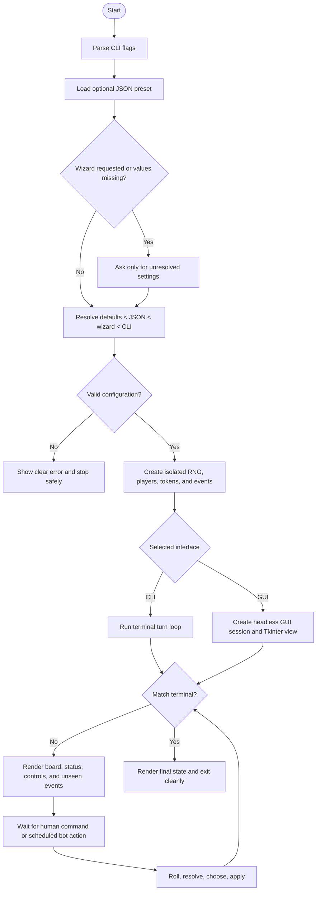
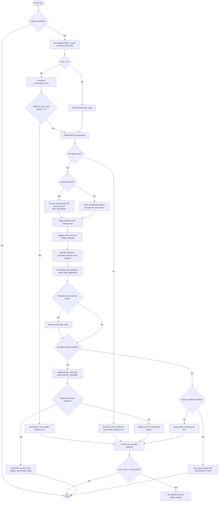

# Flowchart and Pseudocode — CIA1 Multiplayer Ludo

This document describes the control flow implemented independently by
`v1_initial/oop_ludo/` and `v1_initial/func_ludo/`. The shared package supplies
configuration and presentation contracts, not shared gameplay decisions.

## 1. Setup and Match Flow



The GUI scheduler never changes the rules. It asks the session whether an
automated action is available, waits for the configured delay, and performs one
step. Pause suppresses scheduling; manual Step still works.

## 2. Turn Loop



## 3. Coordinate Mapping

```text
FUNCTION get_global_pos(start_index, steps, track_len, outer_last_step):
    IF steps < 0 OR steps > outer_last_step:
        RETURN NULL
    RETURN (start_index + steps) MOD track_len
END FUNCTION
```

`steps == home_finish` is finished. Values from `track_len - 1` through
`home_finish - 1` are private-home cells. Neither has a shared global position.

## 4. Target Computation

```text
FUNCTION compute_target(config, player, token, roll):
    IF token.steps == -1:
        IF roll != 6:
            RETURN NULL
        RETURN target=0, wrapped=false, path=[0]

    IF token.steps == config.home_finish:
        RETURN NULL

    old_steps = token.steps
    raw_target = old_steps + roll
    kill_locked = config.kill_to_enter AND player.captures_made == 0

    IF kill_locked
       AND old_steps BETWEEN 0 AND config.outer_last_step
       AND raw_target >= config.track_len - 1:
        lap_len = config.track_len - 1
        new_steps = raw_target MOD lap_len
        path = [old_steps + 1 .. config.outer_last_step]
        path += [0 .. new_steps]
        RETURN target=new_steps, wrapped=true, path=path

    IF raw_target > config.home_finish:
        IF config.exact_home_roll:
            RETURN NULL
        new_steps = config.home_finish
    ELSE:
        new_steps = raw_target

    path = [old_steps + 1 .. new_steps]
          KEEP ONLY values <= config.outer_last_step
    RETURN target=new_steps, wrapped=false, path=path
END FUNCTION
```

The Kill-to-Enter wrap is the only normal movement case that returns to an
earlier personal step. The `wrapped` flag lets bot progress scoring and move
previews distinguish a full outer loop from backward movement.

## 5. Strict Blockade Path Check

```text
FUNCTION strict_path_blocked(state, player, path):
    IF config.blockades != "strict":
        RETURN false

    FOR EACH personal_step IN path:
        global_pos = get_global_pos(player.start_index, personal_step, ...)
        IF global_pos IS NULL:
            CONTINUE
        FOR EACH opponent IN state.players:
            IF opponent.index == player.index:
                CONTINUE
            IF count_tokens_at(opponent, global_pos) >= 2:
                RETURN true
    RETURN false
END FUNCTION
```

The path includes every crossed outer tile and the landing tile when the
landing is on the outer track.

## 6. Capture Eligibility

```text
FUNCTION capturable_tokens(state, mover, global_pos):
    IF global_pos IS NULL:
        RETURN []
    IF config.safe_tiles_enabled AND global_pos IN config.safe_tiles:
        RETURN []

    captured = []
    FOR EACH opponent IN state.players:
        IF opponent.index == mover.index:
            CONTINUE
        tokens = tokens_at(opponent, global_pos)
        IF config.blockades == "safe_pair" AND LENGTH(tokens) >= 2:
            CONTINUE
        captured += tokens
    RETURN captured
END FUNCTION
```

This function is called both while previewing and while applying. The state has
not changed between those calls in a legal turn, so the preview and applied
capture list match.

## 7. Move Preview

```text
FUNCTION preview_move(state, player_idx, token_idx, roll):
    player = state.players[player_idx]
    token = player.tokens[token_idx]
    target = compute_target(config, player, token, roll)

    IF target IS NULL:
        RETURN { legal: false, reason: "Move is not legal for this roll." }

    IF strict_path_blocked(state, player, target.path):
        RETURN { legal: false, reason: "A strict blockade blocks the path." }

    global_pos = get_global_pos(player.start_index, target.steps, ...)
    captured = capturable_tokens(state, player, global_pos)
    friendly_before = count_tokens_at(player, global_pos)
    blockade_formed = global_pos IS NOT NULL
                      AND friendly_before < 2
                      AND friendly_before + 1 >= 2

    RETURN {
        legal: true,
        label: token.label,
        token_idx: token_idx,
        old_steps: token.steps,
        new_steps: target.steps,
        old_position: format_position(...),
        new_position: format_position(...),
        global_pos: global_pos,
        captured: captured_labels,
        reached_home: target.steps == config.home_finish,
        safe: is_safe_tile(global_pos),
        wrapped: target.wrapped,
        blockade_formed: blockade_formed
    }
END FUNCTION
```

A preview performs no mutation. Human buttons, bot scoring, and tests all use
this same query.

## 8. Roll Processing

```text
FUNCTION process_roll(state, roll):
    player_idx = state.current_player
    emit(state, "DICE_ROLLED", player_idx, { roll: roll })

    IF roll == 6:
        state.consecutive_sixes += 1
        IF config.triple_six_forfeit AND state.consecutive_sixes == 3:
            state.consecutive_sixes = 0
            emit(state, "TRIPLE_SIX_FORFEIT", player_idx)
            advance_turn(state)
            RETURN { event: "TRIPLE_SIX_FORFEIT", valid_moves: [] }
    ELSE:
        state.consecutive_sixes = 0

    valid_moves = get_valid_moves(state, player_idx, roll)
    IF valid_moves IS EMPTY:
        state.consecutive_sixes = 0
        emit(state, "NO_VALID_MOVES", player_idx, { roll: roll })
        advance_turn(state)
        RETURN { event: "NO_VALID_MOVES", valid_moves: [] }

    RETURN { event: "SELECT_MOVE", valid_moves: valid_moves }
END FUNCTION
```

## 9. Move Application

```text
FUNCTION apply_move(state, token_idx, roll):
    player_idx = state.current_player
    player = state.players[player_idx]
    preview = preview_move(state, player_idx, token_idx, roll)
    IF NOT preview.legal:
        RAISE ValueError("Illegal move")

    token = player.tokens[token_idx]
    old_steps = token.steps
    token.steps = preview.new_steps
    emit(state, "TOKEN_MOVED", player_idx, {
        token: token.label,
        token_idx: token_idx,
        roll: roll,
        old_steps: old_steps,
        new_steps: token.steps,
        wrapped: preview.wrapped
    })

    FOR EACH victim IN preview.captured:
        victim.steps = -1
        player.captures_made += 1
        emit(state, "TOKEN_CAPTURED", player_idx, {
            mover: token.label,
            victim_player: victim.owner.index,
            victim_token: victim.label
        })

    IF preview.blockade_formed:
        emit(state, "BLOCKADE_FORMED", player_idx, {
            tile: preview.global_pos,
            token: token.label
        })

    reached_home = preview.reached_home
    IF reached_home:
        state.consecutive_sixes = 0

    player_finished = all_tokens_finished(player, config.home_finish)
    IF player_finished AND player_idx NOT IN state.finish_order:
        APPEND player_idx TO state.finish_order
        emit(state, "PLAYER_FINISHED", player_idx, {
            place: LENGTH(state.finish_order)
        })

    required_finishers = 1
    IF config.podium_mode:
        required_finishers = config.player_count - 1

    won = player_finished AND LENGTH(state.finish_order) >= required_finishers
    bonus_turn = false

    IF won:
        state.status = "WON"
        state.winner_index = state.finish_order[0]
        emit(state, "GAME_WON", state.winner_index, {
            finish_order: COPY(state.finish_order)
        })
    ELSE IF player_finished:
        advance_turn(state)
    ELSE:
        bonus_turn = (roll == 6)
                     OR (captures_exist AND config.bonus_on_capture)
                     OR (preview.reached_home AND config.bonus_on_home)
        IF bonus_turn:
            emit(state, "BONUS_TURN", player_idx, { roll: roll })
        ELSE:
            state.consecutive_sixes = 0
            advance_turn(state)

    RETURN move_result
END FUNCTION
```

`apply_move` owns turn resolution. Callers must not call `advance_turn` again.

## 10. Turn Advancement and Draw

```text
FUNCTION advance_turn(state):
    IF state.status != "PLAYING":
        RETURN

    state.consecutive_sixes = 0
    FOR offset FROM 1 TO LENGTH(state.players):
        candidate = (state.current_player + offset) MOD LENGTH(state.players)
        IF NOT all_tokens_finished(state.players[candidate], config.home_finish):
            state.current_player = candidate
            BREAK

    state.turn_count += 1
    emit(state, "TURN_ADVANCED", state.current_player)

    IF state.turn_count >= state.max_turns:
        state.status = "DRAW"
        state.draw_reason = "Maximum turn limit reached"
        emit(state, "GAME_DRAW", NULL, { reason: state.draw_reason })
END FUNCTION
```

Mutual draw and quit set their terminal fields directly and append `GAME_DRAW`
or `GAME_QUIT`. Neither changes `turn_count`.

## 11. Deterministic Bot Score

```text
FUNCTION bot_score(state, token_idx, roll):
    preview = preview_move(state, state.current_player, token_idx, roll)
    captured_count = LENGTH(preview.captured)
    unlock = config.kill_to_enter
            AND player.captures_made == 0
            AND captured_count > 0
    escape = token_is_in_danger(token)
             AND NOT destination_can_be_captured(preview.global_pos)
    progress = preview.new_steps
    IF preview.wrapped:
        progress += config.track_len

    RETURN (
        preview.reached_home,
        captured_count,
        unlock,
        preview.safe,
        escape,
        progress,
        -token_idx
    )
END FUNCTION

choice = legal_move_with_maximum(bot_score)
```

The tuple order is the priority order. The final negative token index guarantees
that the lowest token index wins an exact tie.

## 12. Canonical Export

```text
FUNCTION export_canonical_state(state):
    RETURN {
        config: deep_copy(state.config),
        max_turns: state.max_turns,
        turn_count: state.turn_count,
        current_player: state.current_player,
        consecutive_sixes: state.consecutive_sixes,
        status: state.status,
        winner_index: state.winner_index,
        draw_reason: state.draw_reason,
        finish_order: COPY(state.finish_order),
        last_event: state.last_event,
        events: deep_copy(state.events),
        players: [
            index, name, kind, color, start_index, captures_made,
            tokens: [{ label, steps }]
        ]
    }
END FUNCTION
```

RNG state is intentionally excluded. The returned object is JSON-serializable
and isolated from live state. Parity tests compare this object after every
roll, bot decision, move, and terminal transition.
