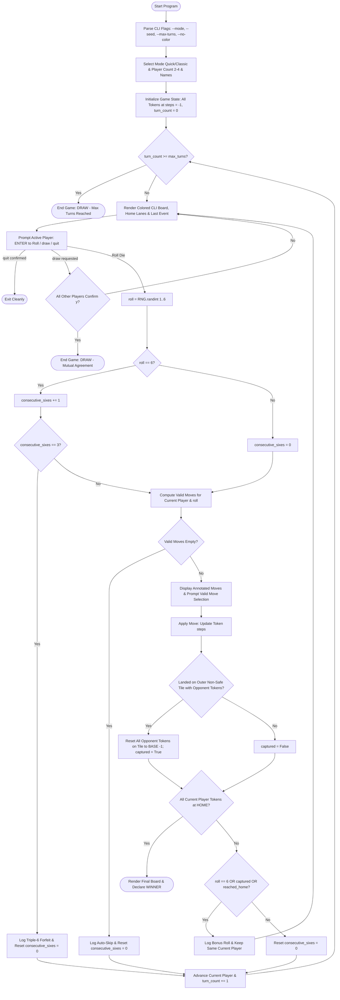

# Flowchart & Pseudocode — Multiplayer Ludo CLI

This document provides the language-agnostic control flow and algorithmic specification implemented identically by both `ludo_oop.py` (Class-Based) and `ludo_func.py` (Function-Based).

---

## 1. Master Turn-Loop Flowchart (Mermaid)



---

## 2. Core Algorithmic Pseudocode

### A. Coordinate Mapping (`GET_GLOBAL_POS`)
```text
FUNCTION GET_GLOBAL_POS(player_start_index, steps, track_len):
    IF steps < 0 OR steps > (track_len - 2):
        RETURN NULL   // Token is in BASE, Private Home Stretch, or HOME
    RETURN (player_start_index + steps) MOD track_len
END FUNCTION
```

### B. Move Validation (`GET_VALID_MOVES`)
```text
FUNCTION GET_VALID_MOVES(state, player_idx, roll):
    config = state.config
    player = state.players[player_idx]
    valid_moves = EMPTY LIST

    FOR EACH token IN player.tokens:
        IF token.steps == -1:
            IF roll == 6:
                target_steps = 0
                APPEND move_preview(token, target_steps) TO valid_moves
        ELSE IF token.steps < config.home_finish:
            IF token.steps + roll <= config.home_finish:
                target_steps = token.steps + roll
                APPEND move_preview(token, target_steps) TO valid_moves

    RETURN valid_moves
END FUNCTION
```

### C. Move Application & Capture Resolution (`APPLY_MOVE`)
```text
FUNCTION APPLY_MOVE(state, player_idx, token_idx, roll):
    config = state.config
    player = state.players[player_idx]
    token  = player.tokens[token_idx]

    old_steps = token.steps
    IF old_steps == -1:
        ASSERT roll == 6
        new_steps = 0
    ELSE:
        new_steps = old_steps + roll
        ASSERT new_steps <= config.home_finish

    token.steps = new_steps
    captured_tokens = EMPTY LIST
    reached_home = (new_steps == config.home_finish)

    // Check captures ONLY on shared outer non-safe tiles
    new_global = GET_GLOBAL_POS(player.start_index, new_steps, config.track_len)
    IF new_global IS NOT NULL AND new_global NOT IN config.safe_tiles:
        FOR EACH other_player IN state.players:
            IF other_player.index == player_idx:
                CONTINUE
            FOR EACH opp_token IN other_player.tokens:
                opp_global = GET_GLOBAL_POS(other_player.start_index, opp_token.steps, config.track_len)
                IF opp_global == new_global:
                    opp_token.steps = -1
                    APPEND (other_player.name, opp_token.label) TO captured_tokens

    // Check win condition
    won = ALL(t.steps == config.home_finish FOR t IN player.tokens)
    IF won:
        state.status = "WON"
        state.winner_index = player_idx

    bonus_turn = (NOT won) AND ((roll == 6) OR (LENGTH(captured_tokens) > 0) OR reached_home)

    RETURN {
        old_steps: old_steps,
        new_steps: new_steps,
        captured: captured_tokens,
        reached_home: reached_home,
        won: won,
        bonus_turn: bonus_turn
    }
END FUNCTION
```

### D. Turn Resolution (`PROCESS_ROLL_PHASE`)
```text
FUNCTION PROCESS_ROLL_PHASE(state, roll):
    IF roll == 6:
        state.consecutive_sixes += 1
        IF state.consecutive_sixes == 3:
            state.consecutive_sixes = 0
            ADVANCE_TURN(state)
            RETURN { event: "TRIPLE_SIX_FORFEIT", valid_moves: [] }
    ELSE:
        state.consecutive_sixes = 0

    valid_moves = GET_VALID_MOVES(state, state.current_player, roll)
    IF valid_moves IS EMPTY:
        state.consecutive_sixes = 0
        ADVANCE_TURN(state)
        RETURN { event: "NO_VALID_MOVES", valid_moves: [] }

    RETURN { event: "SELECT_MOVE", valid_moves: valid_moves }
END FUNCTION

FUNCTION ADVANCE_TURN(state):
    state.consecutive_sixes = 0
    state.current_player = (state.current_player + 1) MOD LENGTH(state.players)
    state.turn_count += 1
    IF state.turn_count >= state.max_turns AND state.status == "PLAYING":
        state.status = "DRAW"
        state.draw_reason = "Maximum turn limit reached"
END FUNCTION
```
