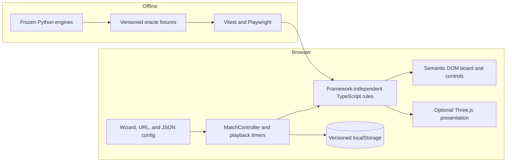

# v3 Browser Release — Implementation Status

- **Status:** implemented local-first release under `web/`; online rooms deferred.
- **Prepared:** 2026-11-25.
- **Implementation evidence updated:** 2026-11-29.
- **Behavioral source of truth:** verified Python code under `v1_initial/`.

This document replaces the earlier future-only build plan with the implemented
v3.0 release record. The approved design and task-by-task plan remain available
at:

- [Local-first web design](superpowers/specs/2026-11-25-v3-local-first-web-design.md)
- [Local-first web implementation plan](superpowers/plans/2026-11-25-v3-local-first-web.md)

## 1. Delivered Scope

The browser release includes:

- local hot-seat play for 2–4 seats;
- independent human/bot assignment for every seat;
- Quick and Classic locked board geometry;
- 1–4 tokens per player;
- Showcase and Classic rule profiles;
- all seven approved boolean rule switches and all blockade modes;
- setup wizard, JSON import/export, and URL configuration;
- deterministic CPython-compatible seeded dice;
- deterministic bot policy and four-bot autoplay;
- gameplay, code, combined, and off commentary;
- pause, single-step, speed, autoplay, and reduced-motion controls;
- mutual draw and confirmed quit flows;
- validated localStorage recovery and corrupt-save reset;
- semantic DOM board and controls;
- optional Three.js presentation with WebGL fallback;
- desktop and mobile Playwright coverage;
- automated WCAG 2.1 A/AA, keyboard, contrast, focus, live-region, and fallback
  checks.

## 2. Explicit Non-Goals

v3.0 does not include:

- online accounts or matchmaking;
- server-authoritative online rooms;
- a database or persistent player profiles;
- analytics payloads or telemetry containing match data;
- a deployed Render backend;
- changes to the frozen Python `v1_initial/` baseline;
- new board geometry or unapproved rule families;
- a claim of human peer testing or human screen-reader testing.

Online multiplayer requires a separate server-authority design. Client-side RNG
is a deterministic test feature, not an anti-cheat boundary.

## 3. Implemented Stack


The application uses Next.js App Router, React, strict TypeScript, CSS Modules,
self-hosted Fontsource fonts, Vitest, Playwright, and axe-core. Python 3.11 is an
offline oracle only. See [`07_web_architecture.md`](07_web_architecture.md) for
component boundaries and data flow.

## 4. Implemented Architecture



`applyMove()` owns post-move resolution exactly once. The controller publishes
cloned canonical snapshots, while React and both renderers consume display
state without mutating tokens.

## 5. Configuration and Rules

Browser precedence is:

```text
URL > imported JSON > wizard > built-in defaults
```

Quick remains a 28-tile route on a 9×9 cross with four Home steps. Classic
remains a 52-tile route on a 15×15 cross with five Home steps. Imported data can
change play rules and seat setup but cannot override locked geometry.

The port includes base unlock, Kill-to-Enter Option A, exact/non-exact Home,
strict and safe-pair blockades, safe tiles, multi-token capture, non-stacking
bonus reasons, triple-six forfeit, auto-skip, Podium Mode, 2P first-finisher
victory, turn-cap draw, mutual draw, and quit.

## 6. Determinism and Parity Evidence

The TypeScript RNG matches CPython 3.11 integer-seed MT19937 behavior for
negative, zero, normal, and large seeds. The fixture manifest records Python
revision `762cb46007c2b77c8bd871ea69bfafd1fd92914e` and SHA-256 hashes for each
oracle file.

Observed full replay:

```text
Web parity matrix: games=1080, wins=362, draws=718,
rolls=93403, moves=71678, snapshots=238919, mismatches=0
```

The replay compares the initial snapshot, every processed roll, every bot
decision, every applied move, and final state. It covers Quick/Classic, 2P/3P/4P,
1–4 tokens, Showcase/Classic profiles, blockade variants, and Kill-to-Enter and
Podium combinations.

## 7. Browser and Accessibility Evidence

The release browser suite runs Desktop Chrome at 1280×720 and Pixel 7 at 412×839.
The observed complete run passed 50 tests. It covers:

- keyboard roll and token selection;
- four-bot autoplay;
- pause and step;
- commentary switching;
- draw and quit;
- JSON/URL precedence and startup timing;
- reload recovery and corrupt-save reset;
- result export and new match;
- mobile overflow and 3D layering;
- automated axe scans;
- dialog focus trapping/restoration;
- focus and fallback-token contrast;
- associated form errors;
- live draw and result announcements;
- reduced motion;
- forced WebGL failure.

Automated checks are not a substitute for human screen-reader testing.

## 8. Persistence and Privacy

The localStorage key is `ludo-showcase:match:v1`. Saves include canonical state,
RNG cursor, pending choices, configuration, and preferences. The complete record
is validated before restore.

- Browser autosave limit: 1 MiB.
- JSON import/export limit: 64 KiB.
- No credentials, account data, analytics payload, or backend storage.
- Match data leaves the browser only through explicit user export.

## 9. Hosting

Vercel is the approved frontend host:

- root directory: `web/`;
- framework preset: Next.js;
- production branch: `main`;
- build command: `npm run build`;
- required secrets: none for local play.

Render is reserved for a future Node WebSocket room service with authoritative
RNG, in-memory rooms, seat/resume tokens, idle expiry, and documented restart
data loss. No placeholder backend is deployed.

Deployment and rollback instructions are in
[`09_deployment.md`](09_deployment.md). The observed production URL and status,
if deployment succeeds, are recorded in [`TRACKER.md`](../TRACKER.md).

## 10. Acceptance Status

| Acceptance item | Status |
|---|---|
| Frozen Python v1 gate | Passed at baseline and rechecked during release |
| TypeScript unit and parity suite | 141 tests passed |
| Full Python oracle replay | 1,080 games, zero mismatches |
| Desktop/mobile browser flows | 50 tests passed |
| Automated accessibility checks | Passed on both browser projects |
| Production build | Passed |
| Genuine human peer testing | Not performed |
| Human screen-reader review | Not performed |
| Online multiplayer | Deferred |
| GitHub push and Vercel production | Recorded in `TRACKER.md` after release steps |
