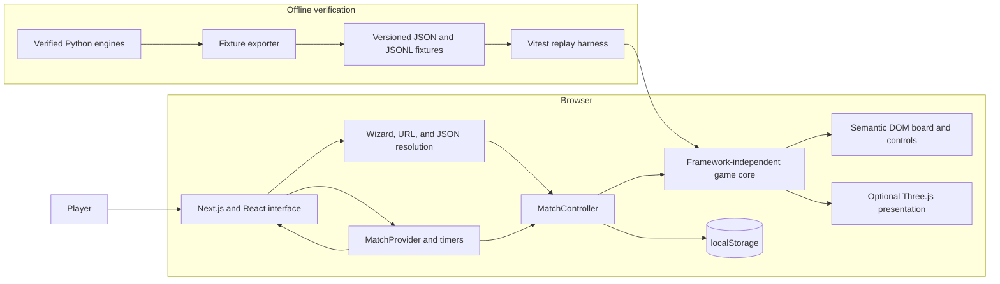
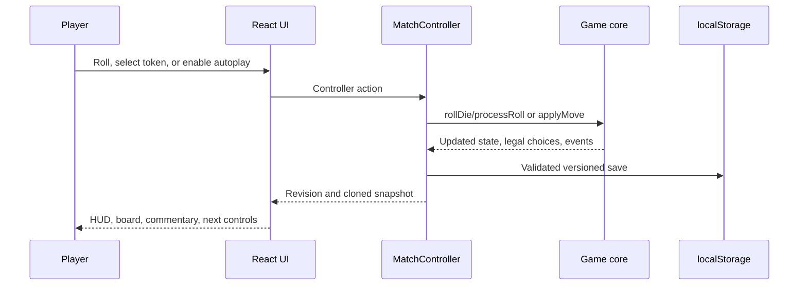
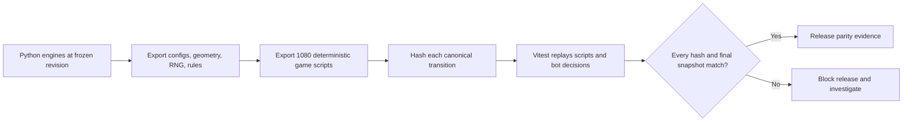

# v3 Web Architecture

- **Release:** local-first browser showcase, v3.0
- **Implementation root:** `web/`
- **Behavioral source of truth:** verified Python code at baseline commit `7d69e15`
- **Oracle fixture revision:** `762cb46007c2b77c8bd871ea69bfafd1fd92914e`

## 1. Stack

| Layer | Technology | Observed version |
|---|---|---|
| Application framework | Next.js App Router | 16.4.6 |
| UI library | React | 19.3.0 |
| Language | TypeScript, strict mode | 5.x lockfile |
| Optional board rendering | Three.js | 0.187.0 |
| Component styling | CSS Modules | Next.js build pipeline |
| Fonts | Fontsource Manrope and Space Grotesk | 5.3.x lockfile |
| Unit and parity tests | Vitest | 5.1.1 |
| Browser tests | Playwright | 1.65.1 |
| Automated accessibility | `@axe-core/playwright` | 4.14.1 |
| Offline oracle | Python | 3.11.0 |
| Frontend hosting | Vercel | deployment configuration |

No database, account system, analytics payload, or backend service is part of
v3.0.

## 2. Runtime Architecture



The dependency direction is intentional: configuration and rules do not depend
on React, and neither board renderer owns rule decisions.

## 3. Component Boundaries

| Path | Responsibility |
|---|---|
| `web/src/game/types.ts` | Canonical configuration, snapshot, event, preview, and game types |
| `web/src/game/presets.ts` | Locked Quick/Classic geometry and rule profiles |
| `web/src/game/config.ts` | Boundary validation and source precedence |
| `web/src/game/rng.ts` | CPython-compatible MT19937 and serialized RNG state |
| `web/src/game/geometry.ts` | Cross, route, Home lanes, yards, and seat mapping |
| `web/src/game/view-model.ts` | Display markers derived from canonical token steps |
| `web/src/game/queries.ts` | Read-only movement, capture, blockade, and danger queries |
| `web/src/game/transitions.ts` | Event creation and safe cloning helpers |
| `web/src/game/engine.ts` | Roll, preview, move, draw, quit, and turn transitions |
| `web/src/game/bot.ts` | Deterministic lexicographic bot policy |
| `web/src/game/commentary.ts` | Gameplay and TypeScript code commentary |
| `web/src/match/controller.ts` | Pending roll, legal choices, playback state, revisions |
| `web/src/match/MatchProvider.tsx` | React subscription, autosave, and timer scheduling |
| `web/src/match/persistence.ts` | Versioned save validation and import/export |
| `web/src/components/setup/` | Setup wizard, URL parsing, and JSON import |
| `web/src/components/match/` | HUD, controls, choices, dialogs, result, commentary |
| `web/src/components/board/DomBoard.tsx` | Complete semantic board and token positions |
| `web/src/components/board/BoardCanvas.tsx` | Optional orthographic Three.js view |

## 4. State Ownership

The engine uses an explicit mutable `InternalGame` object owned by
`MatchController`. Every gameplay change goes through a named transition. The
controller publishes a revision after each action, and `getSnapshot()` returns a
cloned canonical snapshot rather than exposing internal token objects.

`applyMove()` owns all post-move consequences exactly once:

- capture and safe-tile resolution;
- player finish and podium order;
- consecutive-six reset when a token reaches Home;
- bonus selection without stacking;
- turn advance or terminal result.

React never advances the turn after a move. Human choices and bot choices call
the same engine transition.

## 5. Turn and Scheduling Flow



`MatchProvider` schedules at most one automated action with `setTimeout`. It
clears the timer on pause, terminal state, unmount, or controller replacement.
`step()` performs one automated action while paused but never forces a human
token choice.

## 6. Persistence Contract

Storage key: `ludo-showcase:match:v1`.

A saved record contains:

- schema version and timestamp;
- resolved configuration;
- canonical snapshot and ordered events;
- serialized RNG seed, index, and MT19937 words;
- pending roll, legal token indices, and previews;
- paused, autoplay, speed, commentary, and reduced-motion preferences.

Validation rejects unknown fields, malformed configuration, invalid RNG state,
inconsistent player counts, corrupt events, duplicate finish entries, and
pending choices that do not match restored rules. Browser saves are capped at
1 MiB. JSON import/export is capped at 64 KiB.

No credentials are stored. No match data is transmitted by the application.

## 7. Rendering and Fallback

`DomBoard` is always mounted. It renders the route, safe/start markers, Home
lanes, yards, center, token positions, and a screen-reader position list from
the same view model used by Three.js.

`BoardCanvas` adds an orthographic presentation layer only when WebGL is
available. It uses reusable instanced cells, distinct token shapes, deterministic
stack offsets, and legal-destination rings. Rendering occurs on snapshot or
resize changes, not through a perpetual decorative animation loop.

WebGL creation failure or context loss sets `webglAvailable` to false. The
canvas layer becomes inactive and the semantic board remains fully usable.

## 8. Python Parity Pipeline



The observed replay compared 238,919 snapshots across 1,080 games:

```text
games=1080, wins=362, draws=718,
rolls=93403, moves=71678, snapshots=238919, mismatches=0
```

The RNG suite also compares 260,000 generated dice values across 26 seeds.
Fixture hashes and the Python revision are recorded in
`web/fixtures/manifest.json`.

## 9. Security and Privacy Boundary

- URL and JSON inputs are treated as untrusted data.
- Player names and commentary are rendered as text, never injected HTML.
- Locked geometry cannot be overridden by imported configuration.
- Client-side RNG is deterministic for testing, not an anti-cheat boundary.
- No secrets or `NEXT_PUBLIC_*` credentials are required.
- Online play requires a future server-authoritative design; the local client
  must not be trusted with dice, token positions, or winner claims.

## 10. Known Architectural Limits

- Hot-seat players share one browser and screen.
- localStorage is device/browser-local and can be cleared by the user.
- A restored save depends on the current fixture/rules schema.
- Three.js improves presentation but is not required for play.
- Automated accessibility checks do not replace human screen-reader review.
- Online rooms, persistent accounts, and cross-device resume are deferred.
