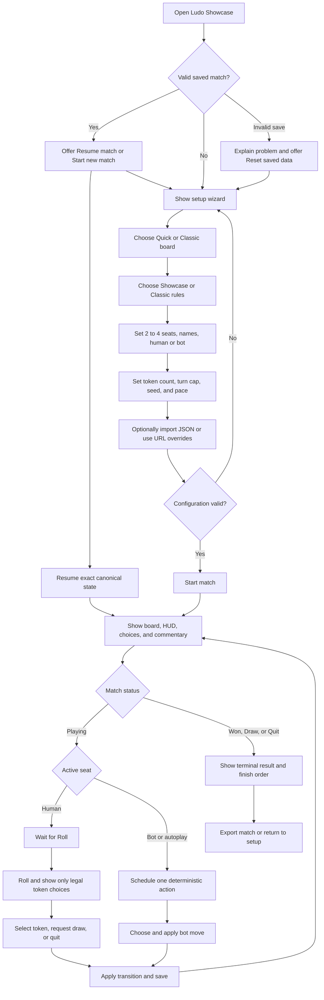
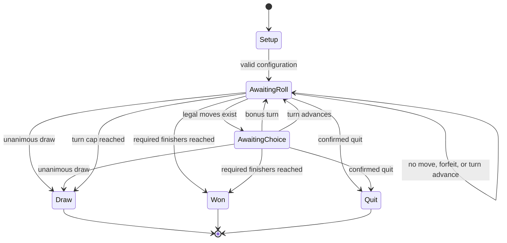
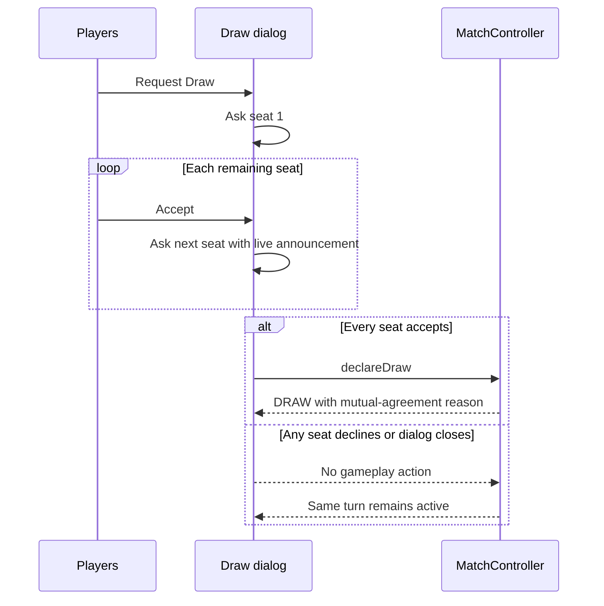
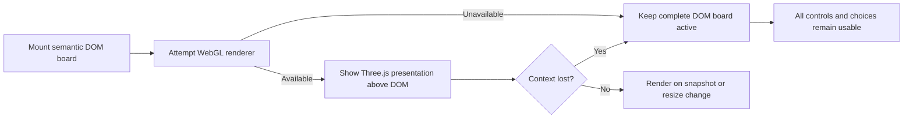

# v3 Web User Flow

This document describes the implemented local-first browser experience. The app
is a hot-seat game: 2–4 people share one browser, and any seat can instead be
assigned to a deterministic bot.

## 1. End-to-End Flow



## 2. Setup and Configuration Precedence

The wizard exposes:

- Quick or Classic locked board geometry;
- Showcase or Classic rule profile;
- 2–4 seats and 1–4 tokens per seat;
- independent human/bot assignment and seat names;
- all seven boolean rule switches;
- blockade mode;
- turn cap and optional seed;
- speed, autoplay, commentary, and reduced motion.

Sources resolve in this order:

```text
URL query parameters > imported JSON > wizard values > built-in defaults
```

The URL accepts canonical names and short aliases:

| Canonical | Alias |
|---|---|
| `player_count` | `players` |
| `tokens_per_player` | `tokens` |
| `max_turns` | `max-turns` |

A deterministic sample URL is:

```text
/?mode=quick&profile=classic&players=2&tokens=1&seed=42&max_turns=120
```

URL resolution finishes before Start becomes enabled. Invalid URL or JSON input
produces an explanation instead of a partial match. Imported JSON is parsed as
data, size-limited, and never executed.

## 3. Human Turn

1. The HUD identifies the active seat.
2. The player selects **Roll**.
3. The engine processes the dice result and computes legal moves.
4. If no move is legal, the turn advances or forfeits automatically.
5. Otherwise, the token-choice list shows only legal buttons with destination,
   capture, safety, wrap, Home, and blockade facts.
6. The player selects one token.
7. `applyMove()` resolves the move, bonus, finish, turn advance, or terminal
   result exactly once.
8. The controller saves the revised state and the UI updates.

A human seat can be driven by autoplay without changing its canonical
`kind: "human"` metadata.

## 4. Bot and Autoplay Turn

Bot seats use the same roll, preview, and move transitions as human seats. The
policy prioritizes:

1. finish Home;
2. capture;
3. unlock Kill-to-Enter;
4. reach a safe tile;
5. escape danger;
6. advance furthest;
7. choose the lowest token index.

Pause stops scheduled actions. Step performs one automated action without
resuming continuous autoplay. Speed changes only the timer delay, never the
rules or dice stream.

## 5. Match State



A bonus roll does not increment the turn count. Reaching Home on a six resets
the consecutive-six streak. Finished seats remain on the podium when Podium Mode
applies and are skipped until the match reaches its required finish count.

## 6. Mutual Draw



The native dialog traps Tab focus, closes on Escape, and restores focus to the
Draw trigger. A decline does not consume a roll or advance the turn.

## 7. Quit and Result

Quit requires confirmation and ends with `GAME_QUIT`. Wins, draws, and quits all
show a terminal result with turns, rolls, mode, and finish order. The result is
announced through a persistent polite status region.

Players can export the validated match as JSON or return to setup. Export is an
explicit user action; the app does not upload match data.

## 8. Save Recovery

After each controller revision, the provider writes a versioned record to
localStorage. On reload, the app validates the complete record before offering
Resume.

A valid restore includes:

- exact canonical snapshot and event history;
- RNG cursor and seed state;
- pending roll and legal choices;
- resolved configuration and player metadata;
- playback and accessibility preferences.

A corrupt or incompatible record shows the reason and a reset action. It does
not crash the application or silently start a different match.

## 9. Keyboard and Accessibility Path

The complete match is operable without a pointer:

1. Tab reaches setup controls in document order.
2. Enter or Space activates the selected control.
3. Start match replaces setup with the match controls; keyboard users continue
   with Tab and Enter.
4. Roll and legal token buttons are native buttons.
5. Draw and Quit use native modal dialogs with trapped focus and restoration.
6. Escape dismisses a dialog without changing gameplay.
7. Focus-visible outlines use a measured high-contrast color.
8. Form errors are associated with their input through `aria-describedby`.
9. Draw handoffs and terminal results use polite live announcements.
10. Reduced motion removes interface transitions.

The semantic board exposes all token positions in text. Three.js is not needed
to understand or play the game.

## 10. WebGL Fallback Path



The automated suite forces WebGL failure and verifies that the accessible board
is visible, no canvas remains, axe reports no WCAG A/AA violations, and controls
still work.

## 11. Verification Coverage

The browser suite runs the same flow tests on Desktop Chrome at 1280×720 and
Pixel 7 at 412×839. The observed release run passed 50 tests:

- keyboard roll and legal token choice;
- four-bot autoplay to a terminal result;
- pause and single-step;
- commentary switching;
- draw decline and mutual acceptance;
- quit confirmation;
- JSON and URL precedence;
- immediate URL startup;
- reload recovery of a pending choice;
- corrupt-save reset;
- result export and new match;
- mobile overflow;
- invalid URL recovery;
- Three.js/DOM layering;
- axe scans, dialog focus, contrast, live regions, reduced motion, and WebGL
  fallback.

These checks do not constitute human screen-reader testing or genuine peer
testing.
