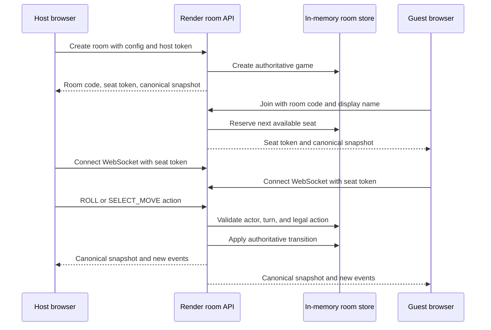

# v3 Deployment and Operations Guide

## 1. Release Topology

```text
GitHub: msvignesh01/ludo-cli
    |
    +-- main branch
            |
            +-- web/ Next.js application --> Vercel frontend hosting

Offline only:
    Python 3.11 engines --> fixture exporter --> committed oracle fixtures

Future phase:
    Browser clients <--> Render Node WebSocket room service
                        with server-authoritative in-memory rooms
```

Vercel hosts the v3.0 frontend. There is no Render deployment, database, account
system, or analytics service in this release.

## 2. Vercel Project Configuration

Use the following settings when importing the repository:

| Setting | Value |
|---|---|
| Framework Preset | Next.js |
| Root Directory | `web` |
| Production Branch | `main` |
| Build Command | `npm run build` |
| Output Directory | Next.js default |
| Install Command | `npm ci` |
| Node.js | 24 or newer |
| Environment Secrets | None required for local play |

The `web/package-lock.json` file pins the dependency graph. Do not deploy from
an uncommitted local build or an unreviewed branch.

## 3. Authentication and CLI Deployment

The observed Vercel CLI version during release preparation was 68.0.0. The CLI
can be run without adding it to the project dependencies:

```bash
cd web
npx vercel --version
npx vercel whoami
```

If `whoami` reports that no account is authenticated, run `npx vercel login` in
an interactive terminal. Do not place tokens in source files, chat, `.env`
files committed to Git, or `NEXT_PUBLIC_*` variables.

Link or create the project with `web/` as the root, then deploy:

```bash
npx vercel link --project ludo-web --yes
npx vercel deploy --prod
```

If the project does not exist yet, create it in the Vercel dashboard with the
settings in Section 2 and link the local directory afterward. Record the
production URL only after the deployment command succeeds.

## 4. Pre-Deployment Gate

Run from the repository root unless a command explicitly says otherwise.

```bash
python scripts/verify_gates.py --stage v1
git diff --check
```

Then run from `web/`:

```bash
npm ci
npm run format:check
npm run lint
npm run typecheck
npm test
npm run test:parity
npm run test:e2e
npm run test:a11y
npm run build
```

Required observed results:

- Python v1 gate exits 0 with zero failures and zero warnings.
- Vitest passes all 141 tests.
- Web parity reports 1,080 games and zero mismatches.
- Playwright passes all 50 desktop/mobile tests.
- Formatting, lint, typecheck, and production build exit 0.
- No cache, credential, `.env`, `node_modules`, `.next`, `test-results`,
  `playwright-report`, or screenshot artifact is staged.

## 5. GitHub Release

The authorized remote is:

```text
https://github.com/msvignesh01/ludo-cli.git
```

Review the complete diff and staged file list before committing. Push only the
reviewed release:

```bash
git status --short
git diff --stat
git diff --check
git push origin main
git ls-remote origin refs/heads/main
```

Do not force-push or rewrite history. The remote `main` commit must match the
local release commit after the push.

## 6. Production Smoke Test

Open the returned Vercel production URL and verify:

1. Setup loads with no browser console errors.
2. A seeded two-seat Quick match starts from the documented URL.
3. A keyboard user can Roll and select a legal token.
4. Four-bot autoplay reaches a terminal result.
5. Pause stops scheduling and Step performs one action.
6. Draw decline preserves the turn; mutual acceptance ends the match.
7. Quit asks for confirmation.
8. A pending choice survives reload.
9. Corrupt localStorage is explained and can be reset.
10. JSON export downloads a valid match file.
11. Desktop and mobile layouts have no horizontal overflow.
12. Forced WebGL failure leaves the semantic board usable.
13. Automated WCAG 2.1 A/AA scans report no violations.
14. No secrets or player match data appear in network requests.

Record the URL, date, viewport(s), and observed result in `TRACKER.md` only
after these checks succeed. A successful local build is not evidence of a
successful Vercel deployment.

## 7. Rollback

Vercel keeps immutable deployments. If production parity, input handling, or
accessibility regresses:

1. Identify the last known-good deployment in the Vercel project.
2. Promote that deployment as the production target.
3. Confirm the production URL serves the expected build.
4. Re-run the setup, seeded match, reload, and mobile smoke checks.
5. Record the rollback and the source commit in `TRACKER.md`.

Do not roll back by deleting evidence or rewriting the GitHub branch.

## 8. Future Render Room Service

Online multiplayer is a separate, unapproved implementation phase. The intended
service is a Node WebSocket room server hosted on Render.



Required future properties:

- server-authoritative RNG and action validation;
- no trust in client-provided dice, token positions, or winner fields;
- short room codes and short-lived seat/resume tokens;
- room-code rate limits and idle-room expiry;
- in-memory rooms only until restart persistence is explicitly required;
- documented data loss on process restart or redeploy;
- a single-instance limitation unless a shared room store is introduced;
- no database until cross-restart persistence becomes a requirement.

The local TypeScript engine can inform the future server, but client-side
randomness and client-declared results must never become the competitive
authority.

## 9. Deployment Status

The authoritative deployment status, production URL if one exists, push commit,
and smoke-test evidence are recorded in [`TRACKER.md`](../TRACKER.md). This guide
does not claim a deployment that has not been observed.
