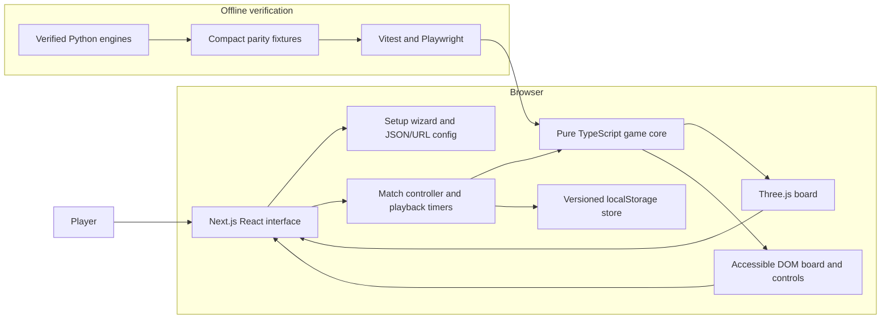
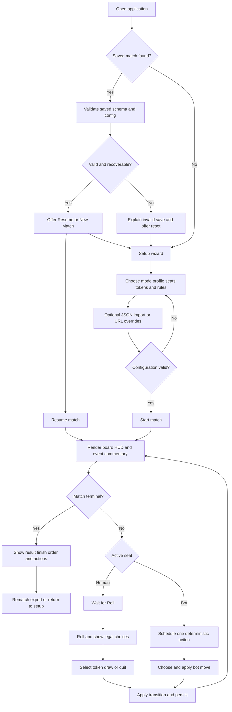
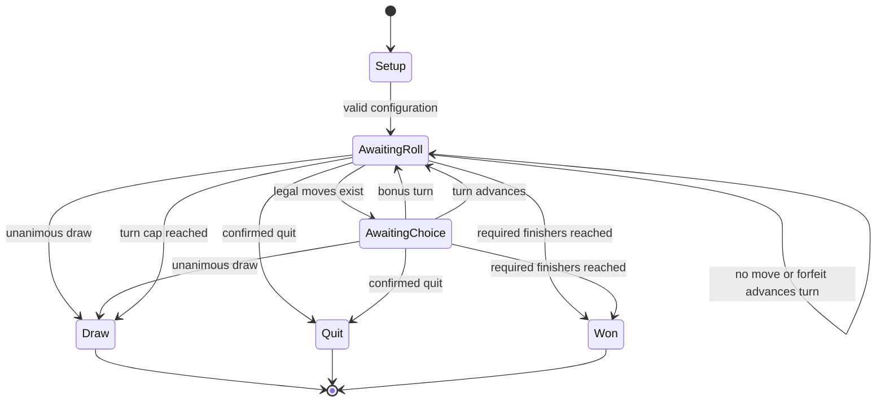
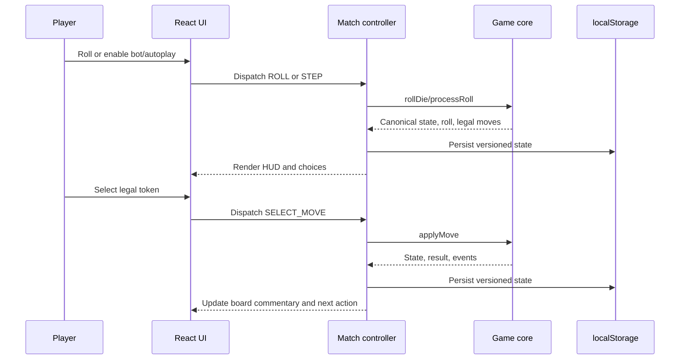
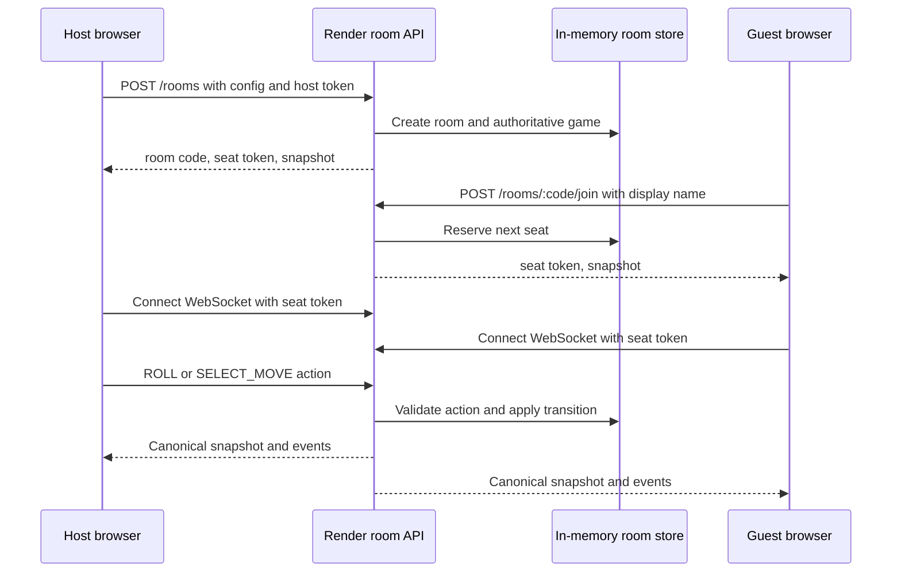

# v3 Local-First Web Design

**Status:** Proposed for final review after direction approval  
**Date:** 2026-11-25  
**Behavioral source of truth:** Verified Python implementation in `v1_initial/`  
**Delivery target:** Responsive browser showcase, deployed to Vercel

## 1. Product Decision

Build the complete Ludo showcase as a local-first web application inside `web/`
in the existing repository. Two to four players share one browser; every seat may
be human or bot. Matches, configuration, and presentation preferences persist in
browser storage and can be exported as JSON.

Vercel hosts the Next.js frontend. No Render service is deployed in this phase
because local play does not need a backend. The repository will include a
concrete server-authority design and message contract so online rooms can be
added later on Render without changing the rules core.

No database is required. Browser storage is suitable for local preferences and
match recovery, but it cannot synchronize different devices. The future online
phase must keep live room state on the server.

## 2. Goals and Non-Goals

### Goals

- Preserve Quick/Classic geometry, all configurable rules, deterministic bots,
  canonical snapshots, event order, and seeded Python-compatible dice behavior.
- Provide a polished responsive interface with an interactive Three.js board and
  a complete accessible DOM fallback.
- Support wizard, JSON, and URL configuration with documented precedence.
- Provide gameplay/code/both/off commentary, pause, step, speed, autoplay, draw,
  quit, rematch, and match export.
- Persist and safely restore local matches across reloads.
- Include measured unit, parity, browser, accessibility, and build evidence.
- Deploy the reviewed frontend to Vercel and push source to the existing
  `msvignesh01/ludo-cli` repository.

### Non-Goals

- Online accounts, matchmaking, chat, payments, profiles, or a database.
- A deployed Render backend in v3.0.
- Server-authoritative or anti-cheat guarantees for local play.
- Changes to the frozen Python implementation or locked board geometry.
- A claim that browser storage provides cross-device multiplayer.

## 3. Approaches Considered

| Approach | Advantages | Tradeoffs | Decision |
|---|---|---|---|
| Local-first app in `web/` | One repository, shared fixtures, simple Vercel deployment, no backend cost | Online play requires a later phase | Selected |
| Separate web repository | Independent release cadence and permissions | Duplicates documentation and fixture plumbing | Rejected |
| Full online backend now | Real cross-device rooms immediately | Render cold starts, room loss on restart, larger security and synchronization scope | Deferred |

The selected approach delivers a complete playable product now while preserving
a clean path to online rooms.

## 4. Technical Stack

- Next.js App Router and React, with versions pinned in `web/package-lock.json`.
- TypeScript in strict mode.
- Three.js for presentation-only board rendering.
- CSS Modules and self-hosted Fontsource fonts; no runtime font fetch.
- Vitest for unit, RNG, geometry, controller, and parity tests.
- Playwright for desktop/mobile browser flows and screenshots.
- `@axe-core/playwright` for automated accessibility checks.
- Python 3.11 only as an offline test oracle and fixture generator.
- Vercel for frontend hosting; Render reserved for the future room service.

The game core must not import React, Next.js, DOM, or Three.js APIs.

## 5. Architecture



### Component Boundaries

1. `src/game/types.ts` defines canonical snapshots, events, configuration, and
   move previews.
2. `src/game/presets.ts` and `config.ts` validate locked geometry and resolve
   defaults, JSON, wizard, and URL values.
3. `src/game/rng.ts` reproduces CPython integer-seed MT19937 dice streams.
4. `src/game/geometry.ts` and `view-model.ts` convert personal steps into board
   cells without embedding rules in rendering.
5. `src/game/engine.ts` owns roll, preview, move, capture, bonus, finish, draw,
   quit, and turn-resolution transitions.
6. `src/game/bot.ts` implements the deterministic lexicographic policy.
7. `src/game/commentary.ts` maps events to gameplay and TypeScript code traces.
8. `src/match/controller.ts` schedules one action at a time and owns pause,
   step, speed, autoplay, and persistence.
9. React components render state and dispatch actions; they never mutate tokens.
10. The Three.js canvas is presentation-only. Every action remains available
    through semantic DOM controls.

## 6. User Flow



## 7. Match State and Persistence

The controller separates canonical game state from presentation state.



Persist under a versioned localStorage key containing:

- schema version and saved timestamp;
- resolved configuration and player names/kinds;
- canonical snapshot and ordered events;
- RNG state or deterministic seed plus roll cursor;
- commentary, speed, autoplay, and reduced-motion preferences.

Validate the entire record before use. A corrupt or incompatible save must not
crash the application; show a reset action and preserve the invalid record only
until the player chooses to replace it. Export/import uses the same validated
schema. Player names and match transcripts are never sent to analytics.

## 8. Rules and Parity Contract

The browser engine mirrors the Python canonical schema and event names. The
personal `steps` coordinate system remains unchanged:

- `-1` is base;
- `0..outer_last_step` is shared track;
- `track_len - 1..home_finish - 1` is private home;
- `home_finish` is finished.

`applyMove` owns post-move resolution exactly once. Reaching home resets the
consecutive-six streak, including when the finishing roll is a six. Bonus reasons
never stack, and bonus rolls do not increment the turn count.

### Compact Oracle Fixtures

The Python exporter writes versioned fixtures containing:

- validated presets and geometry;
- RNG streams for negative, zero, large, and twenty fixed seeds;
- unit-level action examples for every rule family;
- all 1,080 deterministic game action scripts;
- final canonical snapshots and SHA-256 transition chains for each game.

Vitest replays every action script, recomputes bot choices, compares every
canonical transition hash, and deep-compares final state. This avoids committing
hundreds of megabytes of repeated snapshots while still checking every action.

A parity release is blocked by any skipped scenario, hash mismatch, final-state
mismatch, bot-choice mismatch, or fixture schema/revision mismatch.

## 9. Visual and Interaction Direction

The visual direction is a premium tabletop game-night interface:

- deep ink background, warm ivory panels, restrained gold accents;
- Space Grotesk for headings and Manrope for body text, self-hosted;
- player colors reinforced by labels and shapes rather than color alone;
- board left and match panel right on desktop;
- board above a collapsible panel on tablet;
- compact board and sticky action area on mobile;
- visible focus rings, 44×44 CSS pixel minimum targets, semantic headings, and
  live regions for turn changes and errors;
- no infinite decorative motion and full `prefers-reduced-motion` support.

The Three.js view uses a fixed orthographic camera, deterministic stack offsets,
selection highlights, and Reset View. The DOM board remains fully playable when
WebGL is unavailable.

## 10. Browser Automation Sequence



Pause cancels scheduling but manual Step remains available. Timers are cleared
on pause, unmount, terminal state, and configuration changes.

## 11. Verification Gates

The web project must pass:

```text
npm run lint
npm run typecheck
npm test
npm run test:parity
npm run test:e2e
npm run test:a11y
npm run build
```

Additional release checks:

- all Python rule intents have browser unit coverage;
- 10,000 dice rolls match Python for every fixed RNG seed;
- all 1,080 oracle games match every transition hash and final snapshot;
- desktop and mobile complete a scripted match;
- keyboard-only play, localStorage resume, corrupt-save recovery, JSON/URL
  validation, draw, quit, pause, step, and WebGL fallback pass in Playwright;
- no critical or serious automated accessibility findings;
- final UI is inspected in a real browser at desktop and mobile sizes;
- production build and Vercel preview pass the same smoke flow.

## 12. Hosting and Release

### Vercel

- Project root: `web/`.
- Framework preset: Next.js.
- Production branch: `main`.
- Build command: `npm run build`.
- No environment secrets are required for local play.
- Preview deployments must pass build and smoke checks before production.
- Roll back to the previous immutable Vercel deployment if a release regresses.

### GitHub

- Remote: `https://github.com/msvignesh01/ludo-cli`.
- Commit reviewed source, documentation, lockfile, and deployment configuration.
- Exclude credentials, local environment files, caches, test artifacts, and
  generated browser binaries.
- Push only after all release gates pass.

### Render, future phase only

Render will host a Node WebSocket room service when online play is approved. The
service will own RNG and canonical state, issue short room codes and resume
tokens, validate every action, expire idle rooms, and keep live rooms in memory.
The current repository documents this contract but does not deploy a placeholder
backend.

## 13. Future Online Room Contract



Required future properties:

- server-authoritative RNG and actions;
- no trust in client-provided dice, token positions, or winner fields;
- short-lived seat/resume tokens and room-code rate limits;
- idle-room expiry and explicit restart/redeploy data-loss behavior;
- no database until persistence across restarts becomes a requirement;
- a documented single-instance limitation for in-memory rooms.

## 14. Acceptance Criteria

1. The Python v1 gate remains unchanged and passing.
2. The web app installs, lints, typechecks, tests, and builds from a clean checkout.
3. Every fixed RNG fixture and all 1,080 game fixtures match Python.
4. A complete local match is playable by mouse and keyboard on desktop and mobile.
5. Reload restores a valid match; corrupt storage recovers without a crash.
6. The DOM fallback completes a match with WebGL disabled.
7. Automated accessibility has no critical or serious findings.
8. Documentation includes stack badges and Mermaid architecture, user-flow,
   state, automation, and future-online sequence diagrams.
9. Reviewed source is pushed to `msvignesh01/ludo-cli` without secrets or caches.
10. The Vercel production URL is recorded only after deployment and smoke checks
    actually succeed.
